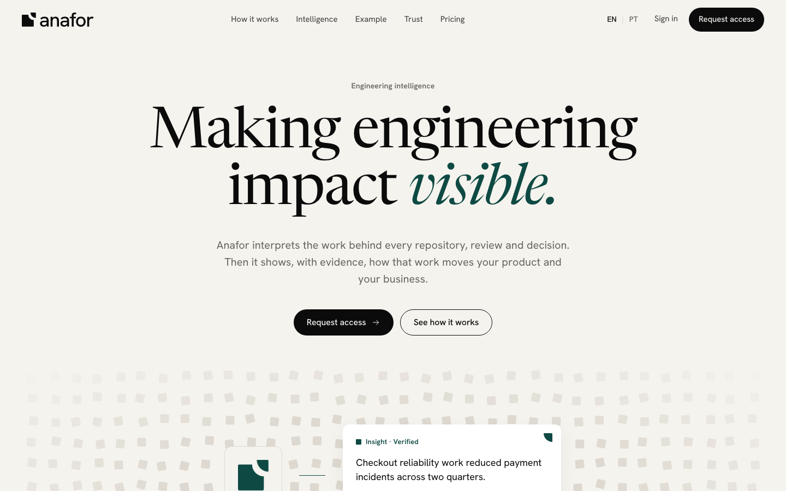

# Anafor — site institucional

Landing page de uma página da Anafor (*Making engineering impact visible.*), com navegação por âncoras.

**Stack:** Next.js 15 (App Router) · TypeScript · Tailwind CSS v4 · Motion · GSAP ScrollTrigger · Lenis · next-intl.



## Como rodar

```bash
npm install
cp .env.example .env.local   # preencha os valores
npm run dev                   # http://localhost:3000
```

Produção:

```bash
npm run build && npm start
```

Capturas de tela (desktop 1440 px e mobile 390 px, salvas em `docs/screenshots/`), com o servidor rodando:

```bash
npx playwright install chromium   # uma vez; ou use CHROME_PATH=/caminho/do/chromium
node scripts/screenshots.mjs
```

## Estrutura

```
app/
  [locale]/layout.tsx     fontes locais, metadata por idioma, JSON-LD Organization, providers
  [locale]/page.tsx       ordem das seções
  actions/request-access.ts  server action do formulário (envia para FORM_ENDPOINT)
  sitemap.ts · robots.ts  (imagem de Open Graph em public/og.png)
i18n/routing.ts           idiomas e rotas · middleware.ts aplica o roteamento
  fonts/                  Newsreader, Hanken Grotesk e Geist Mono em woff2, subset latin
components/
  sections/               uma seção por arquivo (Header, Hero, Problem, Example, HowItWorks,
                          Evidence, Intelligence, Leaders, Results, Trust, Foundations,
                          Pricing, FinalCta, Footer)
  visuals/                visuais interativos (campo de quadrados, fragmentos, passos, demo do assistente, abas, motor de inteligência)
  motion/                 Reveal, RevealHeading, Lenis, MotionConfig
  brand/BrandSvg.tsx      insere os SVGs oficiais de /public/brand sem recriá-los
  ui/                     ícones, chip de evidência, diálogo de Request access
messages/                 en.json e pt-BR.json (revise a tradução antes de publicar)
styles/anafor-tokens.css  cópia literal de anafor-branding/04-cores-e-tokens
public/brand/             logos copiados de anafor-branding/01-logo
```

## Branding

- Cores apenas de `anafor-tokens.css`, mapeadas no `@theme` do Tailwind (`bg-paper`, `text-ink`, `text-teal`…). A paleta padrão do Tailwind foi removida (`--color-*: initial`), então classes fora da marca não compilam.
- Logos e símbolo vêm dos arquivos oficiais. O "quarto levantado" é animado direto sobre o segundo `<path>` do SVG original: hover do logo, abertura do hero e passo *Connect*.
- Rótulos e eyebrows usam o token `label` da marca (Hanken Grotesk 13/600, tracking 0.01em, caixa normal), não Geist Mono em caixa alta, que deixava a página com cara de gerada por IA. O Geist Mono ficou só para código de verdade (chaves como `COM-103`).
- Os textos não usam travessão (—), pelo mesmo motivo.
- Fontes: os TTF de `05-tipografia` foram convertidos para woff2 com subset latin. O eixo `wght` da Newsreader ficou fixo em 400 (de 137 KB para 54 KB).

## Movimento

- Assinatura: o quarto sai do encaixe (−16, +16 no grid 104) e sobe até o lugar dele em 600 ms, com `cubic-bezier(.2,.7,.2,1)`.
- O H1 do hero é revelado palavra por palavra só com CSS, para o LCP não depender de JS. Os demais títulos usam Motion `whileInView` (stagger de 40 ms, uma vez).
- Problem: GSAP ScrollTrigger (scrub) alinha os fragmentos.
- How it works: coluna fixa com crossfade e barra de progresso em teal-light. No mobile, os passos ficam empilhados.
- Hero: o canvas de quadrados só carrega quando o navegador fica ocioso, apenas em dispositivos com mouse. Pausa fora da tela e quando está parado. O fallback é um padrão estático.
- `prefers-reduced-motion`: sem Lenis, sem canvas, sem transforms. Fica só fade ou o estado final.

## Idiomas

- Inglês em `/` e português em `/pt-BR`, as duas páginas geradas estaticamente (`app/[locale]/`, next-intl com `localePrefix: "as-needed"`).
- O seletor **EN | PT** fica no header (desktop e mobile) e no rodapé. Não há detecção automática pelo navegador: quem escolhe é o visitante. `/en` redireciona para `/`.
- Metadata com `hreflang` (`en`, `pt-BR`, `x-default`), e o sitemap lista as duas URLs.
- Textos em `messages/en.json` e `messages/pt-BR.json` (mesmas chaves). Para adicionar um idioma, inclua-o em `i18n/routing.ts` e crie o arquivo de mensagens.

## Qualidade (Lighthouse 12, build de produção local)

| Perfil | Performance | Acessibilidade | Boas práticas | SEO | LCP | CLS |
|---|---|---|---|---|---|---|
| Desktop | 100 | 100 | 100 | 100 | 0,7 s | 0 |
| Mobile (4G lento simulado) | 91 | 100 | 100 | 100 | 3,5 s | 0 |

No mobile simulado, a performance ficou abaixo da meta de 95 e o LCP acima de 2,0 s. O elemento de LCP é o H1. Desativar a animação dele não muda o resultado: o atraso vem do modelo de simulação, que coloca os chunks de JS (~141 KB compartilhados) no caminho do primeiro paint. Próximos passos possíveis: medir em produção com CDN (field data); carregar Motion de forma lazy fora do hero; trocar o `layoutId` das abas por CSS.

## Placeholders a preencher

| Placeholder | Onde | O que é |
|---|---|---|
| `[SITE_URL]` | `NEXT_PUBLIC_SITE_URL` / `lib/site.ts` | Domínio canônico (padrão provisório: `https://anafor.ai`) |
| `[APP_URL]` | `NEXT_PUBLIC_APP_URL` | Destino do link "Sign in" (hoje `#`) |
| `[CONTACT_EMAIL]` | `NEXT_PUBLIC_CONTACT_EMAIL` | E-mail do "Talk to us", do rodapé e do JSON-LD (padrão provisório: `hello@anafor.ai`) |
| `[FORM_ENDPOINT]` | `FORM_ENDPOINT` (+ `FORM_ENDPOINT_TOKEN` opcional) | Destino do formulário Request access. Sem ele, em produção o formulário mostra erro; em dev só registra no log |
| `[PRICE]` | `messages/*.json` → `pricing.price` | Preço da assinatura base e do consumo de IA |
| `[METRIC]` | `components/sections/Results.tsx` (comentado) | Métrica real por resultado, com fonte |
| `[CUSTOMER QUOTE]` | `components/sections/Results.tsx` (comentado) | Depoimento real e aprovado: `[NAME]`, `[ROLE]`, `[COMPANY]` |
| `[ABOUT_URL]` · `[PRIVACY_URL]` · `[TERMS_URL]` | `lib/site.ts` | Links do rodapé (hoje `#`) |

Os dados dos mocks (exemplo do Kafka, assistente, abas For leaders, How it works, card do hero) são ilustrativos e estão marcados como **Sample data** na interface. Não há números de resultado, depoimentos nem logos de clientes.

## Validar antes de publicar

- **Anafor Trust** (`messages/*.json` → `trust.commitments`, `trust.everyPlan`, `trust.message`): o posicionamento original diz que essas garantias são a direção estratégica e precisam ser validadas antes de serem comunicadas como implementadas. Confirme com engenharia, jurídico e os contratos dos fornecedores de IA (sobretudo a Zero Training Policy) antes de ir ao ar. Se alguma ainda não estiver pronta, remova o item ou ajuste o texto.
- O primeiro compromisso chegou truncado no texto de origem; foi publicado como **Secure by Design**. Confirme o nome.
- **Anafor Intelligence Engine** (`intelligence.capabilities`): confira se as sete capacidades descrevem o que o produto faz hoje. Para marcar uma capacidade que ainda está em construção, preencha o campo `stage` com qualquer texto (ex.: `"wip"`): aparece o selo "In development" / "Em desenvolvimento" ao lado do nome. Hoje todas estão sem selo.
- A visualização do motor (`components/visuals/EngineVisual.tsx`) é conceitual: fragmentos entram, se organizam nos domínios Engenharia, Produto e Negócio e se conectam pelo centro. Ela não representa a topologia real de agentes nem nenhum detalhe de implementação, e a seção não cita provedores de modelo.
